# ω^k+1 個の無限ホップを持つ無限フラクタル迷路
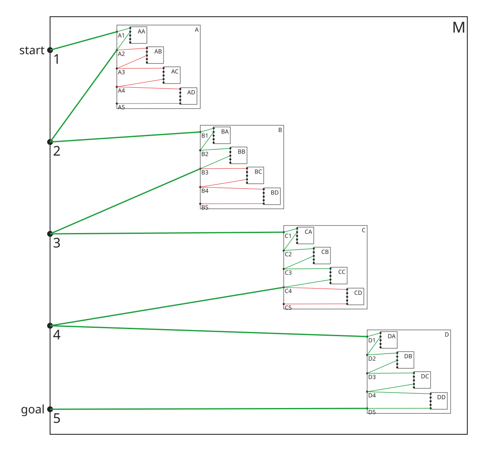

**フラクタル迷路**は同じ迷路の縮小版が再帰的に埋め込まれる構造を持つ迷路である。

下記は Mark J. P. Wolf(1999) によるフラクタル迷路の例 "FRACTAL MAZE" である。
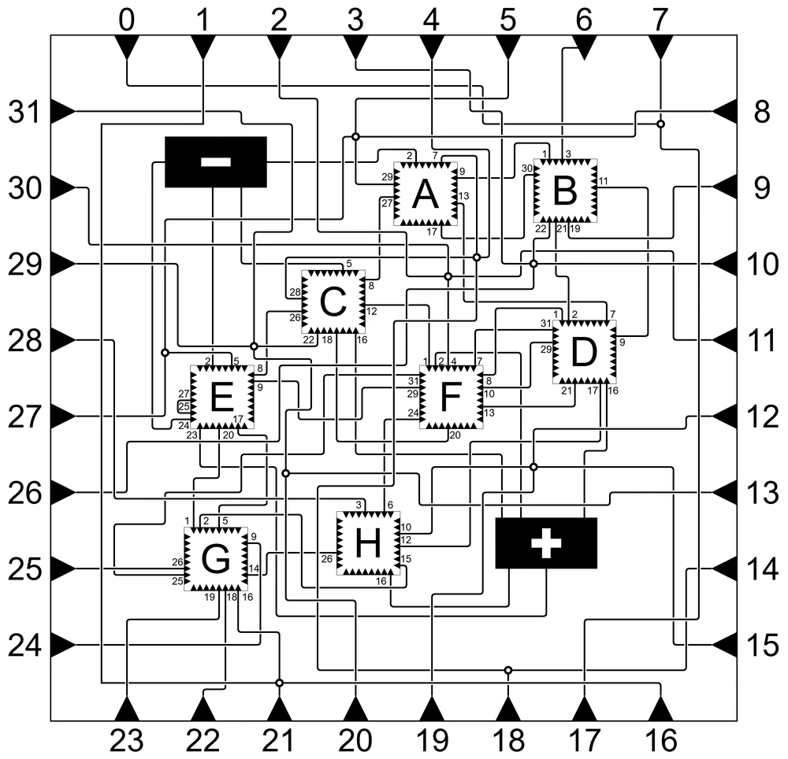

フラクタル迷路については[繰り返し迷路の歴史](https://googology.fandom.com/ja/wiki/%E3%83%A6%E3%83%BC%E3%82%B6%E3%83%BC%E3%83%96%E3%83%AD%E3%82%B0:Koteitan/%E7%B9%B0%E3%82%8A%E8%BF%94%E3%81%97%E8%BF%B7%E8%B7%AF%E3%81%AE%E6%AD%B4%E5%8F%B2)に詳しい解説がある。

## 無限フラクタル迷路
普通のフラクタル迷路では、解の経路が連結していなければならない。 サブ迷路に無限に潜っていった先の点は、 どの通路の上にもないので、 連結な経路が通る通路は有限本で、 サブ迷路に潜る深さも有限である。

サブ迷路に無限に潜っていくと、 2 本の経路が同じ点に限りなく近づき、 その間の隙間の幅が 0 になることがある。 この隙間を飛び越えてよいかについて、 Siggy (2023) は次のように述べている。

> 数学的に言えば、いいえ、それは許されません。幅がゼロの隙間も隙間です。その隙間を飛び越えるのは明らかに不正行為です。ですから、幅がゼロの隙間を飛び越えることを許可するという新しいルールを導入する必要があります。

そこで Siggy は、 幅 0 の隙間を飛び越えること (**無限ホップ**) を決まった条件のもとで認める、 **無限フラクタル迷路** を考えた。 無限ホップを使った解の経路は、 飛び越えた点で切れているので、 連結ではない。

本稿では次の記法を使う。

- 迷路全体を $M$ と書く。 $M$ の中には、 $M$ 自身の縮小コピーであるサブ迷路 $A, B, C, \ldots$ が入っている。 どのサブ迷路も中身は $M$ と同じなので、 $M$ の辺はどの階層のコピーにも同じように入っている。
- 迷路の中の点 (分岐点、 ターミナル) を $1, 2, 3, \ldots$ と番号で呼ぶ。
- サブ迷路の名前を外側から順に並べ、 最後に分岐点の番号を付けたものを **アドレス** と呼ぶ。 例えば $BA1$ は「 $B$ の中の $A$ の中の分岐点 $1$」である。
- $A$ に無限に潜った先の点を $A^\omega$ と書く ($A, AA, AAA, \ldots$ の箱が縮んでいく先の 1 点)。 $(BA)^\omega$ なども同様である。
- 2 つの分岐点を結ぶ通路を **辺** と呼び、 $1 - A1$ のように両端のアドレスで書く。 $M$ の辺は、 $M$ の分岐点どうし、 または $M$ の分岐点とサブ迷路の分岐点を結ぶ。 サブ迷路 $W$ の中には、 $M$ の辺をずらしたコピーがある。 例えば $M$ の辺 $1 - A1$ のコピーとして、 $W$ の中に辺 $W1 - WA1$ がある。
- アドレスの有限列 $a_0, a_1, \ldots, a_m$ で、 となり合う $a_{i-1}$ と $a_i$ が「辺 1 本」または「それまでに認められた無限ホップ 1 回」でつながっているものを、 $a_0$ から $a_m$ への **経路** と呼び、 $a_0 \rightarrow a_m$ と書く。 例えば、 無限ホップ $1 \rightsquigarrow 2$ が認められていて辺 $2 - B1$ があれば、 列 $1, 2, B1$ は経路 $1 \rightarrow B1$ である。
- start から goal への経路を **解** と呼ぶ。 解の中の無限ホップを辺だけの動きに展開すると、 $1 \rightarrow A1 \rightarrow AA1 \rightarrow \cdots$ のように無限に続く動きになる。 以下の例の節で「経路は $\cdots$ と進む」と書くときは、 この展開した動きを指す。

解の経路が無限ホップで飛び越える点を **ホップ点** と呼ぶ。 本稿では、 ホップ点を経路が通る順に並べたときの順序型を「無限ホップの個数」と呼ぶ。

図の見方は次の通りである。

- 外枠が迷路全体 $M$、 中の四角がサブ迷路で、 右上にアドレスを書いた。
- 黒丸が分岐点である。 3 階層目より深い箱では、 分岐点の名前を省いた。
- 緑の線は解の経路で使う辺、 赤の線は使わない辺である。

### 無限ホップルール
Siggy による無限ホップルールの定義を引用する。

> The Infinite Hop rule: You may hop between two addresses under the following conditions:
>
> - Let S, T, U, and V be arbitrary submaze strings. S, U, and V may be empty strings, but T must be non-empty.
> - Let 1 and 2 be arbitrary junctions.
> - The two addresses may be expressed as SU1 and SV2.
> - You show that there is a path from U1 to TU1.
> - You show that there is a path from V2 to TV2.

日本語訳:

> **無限ホップルール**: 次の条件を満たすとき、 2 つのアドレスの間をホップしてよい。
>
> - $S, T, U, V$ を任意のサブ迷路列とする。 $S, U, V$ は空列でもよいが、 $T$ は空列であってはならない。
> - $1$ と $2$ を任意の分岐点とする。
> - 2 つのアドレスが $SU1$ と $SV2$ の形で書ける。
> - $U1$ から $TU1$ への経路があることを示す。
> - $V2$ から $TV2$ への経路があることを示す。

ラフな言い方をすると、繋がっていない経路同士の隙間がある長さ以下であれば **ホップ** してもいいとした場合に、0 以上のいかなる短いホップしか許されない場合にも、ある階層にてその隙間をホップしてゴールに到達することが出来る場合にはホップを許す、というようなルールである。

$U1 \rightarrow TU1$ の経路があれば、 自己相似性から $TU1 \rightarrow TTU1$, $TTU1 \rightarrow TTTU1$, $\ldots$ の経路もある。 したがって $U1$ から出発した経路は $T^\omega$ に限りなく近づく。 $V2$ からの経路も同じ $T^\omega$ に近づくので、 その点で 2 本の経路の隙間は 0 になる。

なお、 ルールの「経路」には、 それより前に認められた無限ホップを含めてよい。 これは Siggy の記事の Simple Nested Maze (後述の $\omega+1$ 個の例) の解説で使われている読み方である。 ただし、 認めようとしているホップ自身を、 その経路の中で使うことはできない。

### 1 個の無限ホップをもつ無限フラクタル迷路の例
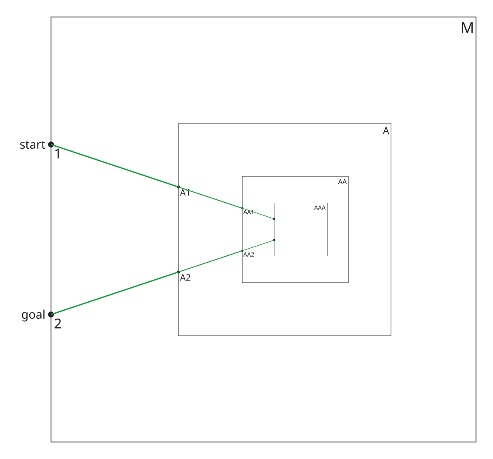

辺は $1-A1$, $2-A2$ の 2 本である。

経路は、 $start=1 \rightarrow A1 \rightarrow AA1 \rightarrow AAA1 \rightarrow AAAA1 \rightarrow \cdots$ と進んでいって迷路 $A^{\omega}$ で無限ホップし、 $A^{\omega}$ 内のターミナルのどこにでも行くことが出来る。そこから $\cdots \rightarrow AAAA2 \rightarrow AAA2 \rightarrow AA2 \rightarrow A2 \rightarrow 2=goal$ と戻ってゴールに到達する。

ルールでは $S=U=V=\varepsilon$ (空列)、 $T=A$ とし、 経路 $1 \rightarrow A1$ と $2 \rightarrow A2$ はどちらも辺 1 本である。 ホップ点は $A^\omega$ の 1 個である。

これは [Infinite Fractal Mazes](https://freethoughtblogs.com/atrivialknot/2023/10/21/infinite-fractal-mazes/) の図 1 に対応する。

### 2 個の無限ホップをもつ無限フラクタル迷路の例
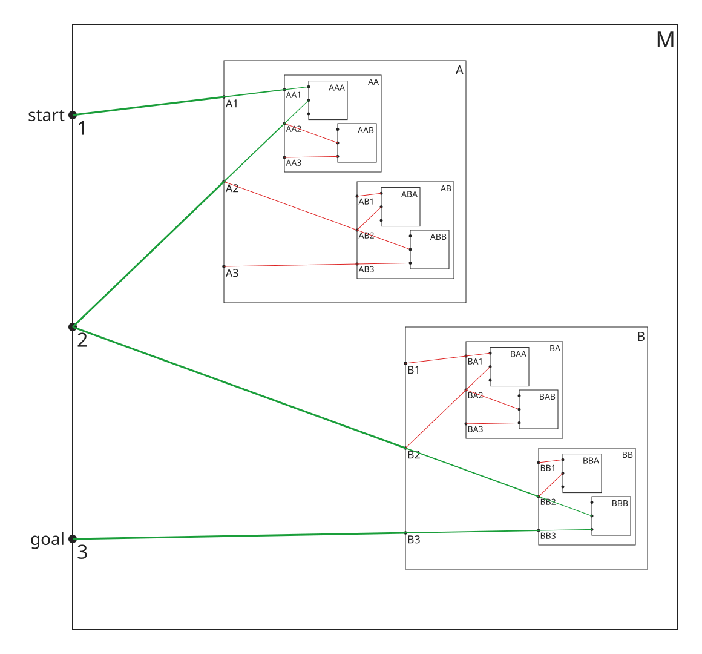

辺は $1-A1$, $2-A2$, $2-B2$, $3-B3$ の 4 本である。

経路は、 $start=1 \rightarrow A1 \rightarrow AA1 \rightarrow \cdots$ と進んで迷路 $A^{\omega}$ で 1 個目の無限ホップをし、 $\cdots \rightarrow AA2 \rightarrow A2 \rightarrow 2$ と戻る。 続けて $2 \rightarrow B2 \rightarrow BB2 \rightarrow \cdots$ と進んで迷路 $B^{\omega}$ で 2 個目の無限ホップをし、 $\cdots \rightarrow BB3 \rightarrow B3 \rightarrow 3=goal$ と戻ってゴールに到達する。

ルールでは、 1 個目は $T=A$ で $1$ と $2$ を、 2 個目は $T=B$ で $2$ と $3$ を繋ぐ。 どちらも 1 個の例と同じ形の無限ホップである。 ホップ点は $A^\omega$, $B^\omega$ の 2 個である。

$1$ と $3$ を 1 回の無限ホップで繋ぐことはできない。 ホップを使わずに $1$ から行ける点は $A^n1$ だけ、 $3$ から行ける点は $B^n3$ だけなので、 $1$ の側の $T$ は $A^n$、 $3$ の側の $T$ は $B^n$ に限られ、 共通の $T$ がないからである。

同じように鎖を長くすれば、 任意の有限個 $n$ 個の無限ホップをもつ例が作れる。

### ω+1 個の無限ホップをもつ無限フラクタル迷路の例
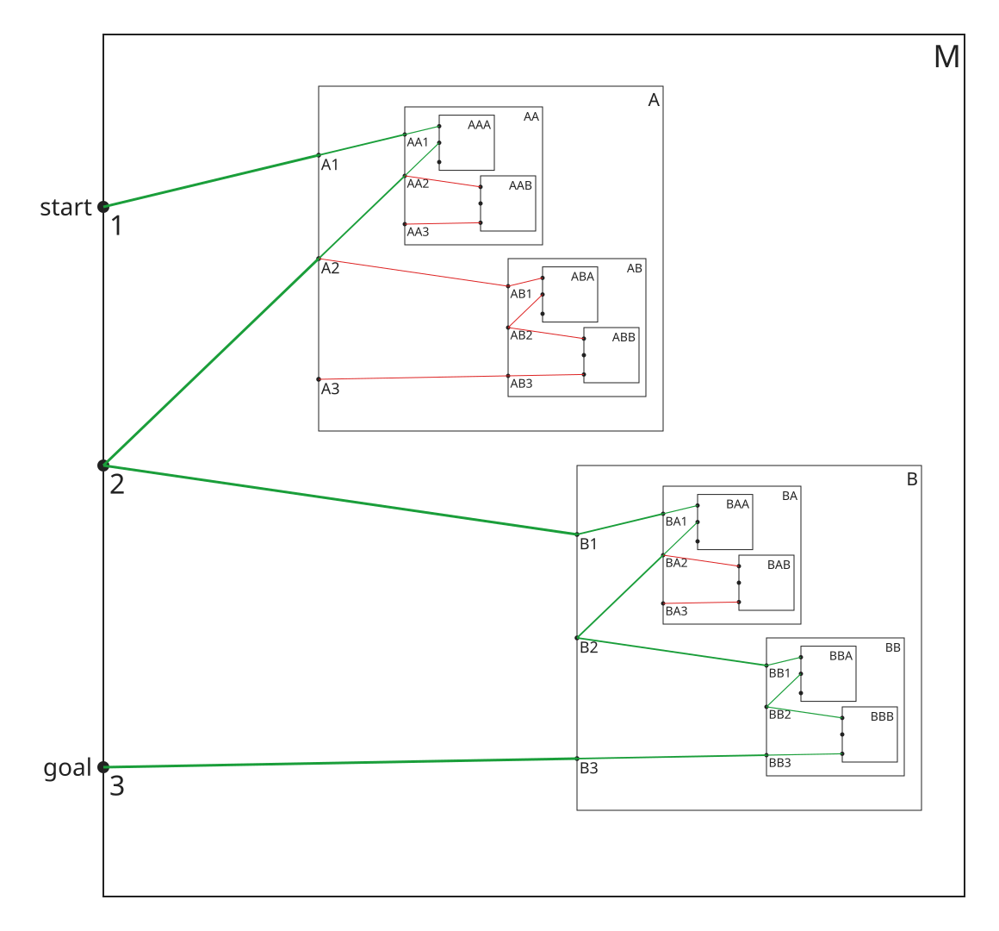

辺は $1-A1$, $2-A2$, $2-B1$, $3-B3$ の 4 本である。 2 個の例の辺 $2-B2$ を $2-B1$ に変えたものである。

経路は、 $start=1$ から 1 個の例と同じ無限ホップ ($A^{\omega}$) で $2$ に行き、 $2 \rightarrow B1$ と進む。 $B1$ は $B$ の中の $1$ なので、 $B$ の中で同じことを繰り返す。 $B1$ から $BA^{\omega}$ で無限ホップして $B2$ に行き、 $B2 \rightarrow BB1$ と進む。 これを繰り返すと、 経路は $B^{\omega}$ に限りなく近づく。 そこで無限ホップし、 $\cdots \rightarrow BB3 \rightarrow B3 \rightarrow 3=goal$ と戻ってゴールに到達する。

ホップ点を通る順に並べると次のようになる。

```math
A^\omega \lt  BA^\omega \lt  BBA^\omega \lt  BBBA^\omega \lt  \cdots \lt  B^\omega
```

$B^nA^\omega$ ($n = 0, 1, 2, \ldots$) が $\omega$ 個、 その後に $B^\omega$ が 1 個あるので、 無限ホップの個数は $\omega+1$ である。

ルールでは、 まず $T=A$ で $1$ と $2$ を繋ぐ (1 個の例と同じ)。 次に $T=B$ で $1$ と $3$ を繋ぐ。 このときの経路 $1 \rightarrow B1$ は、 $1 \rightsquigarrow 2 - B1$ と 1 つ目の無限ホップ $\rightsquigarrow$ を使う。 経路 $3 \rightarrow B3$ は辺 1 本である。

これは [Infinite Fractal Mazes](https://freethoughtblogs.com/atrivialknot/2023/10/21/infinite-fractal-mazes/) のFigure 2: Simple Nested Maze に対応する。 Siggy は、 2 つ目のホップは無限個の無限ホップを必要とする、 と書いている。

### ω2+1 個の無限ホップをもつ無限フラクタル迷路の例
[Infinite Fractal Mazes](https://freethoughtblogs.com/atrivialknot/2023/10/21/infinite-fractal-mazes/) では、**The Cantor Hop rule** を導入して $2^{\aleph_0}$ 個の無限ホップをもつ例を作っている。しかし、 $\omega+1$ と $2^{\aleph_0}$ の間の順序数型の例は作られていないので、作ってみる。

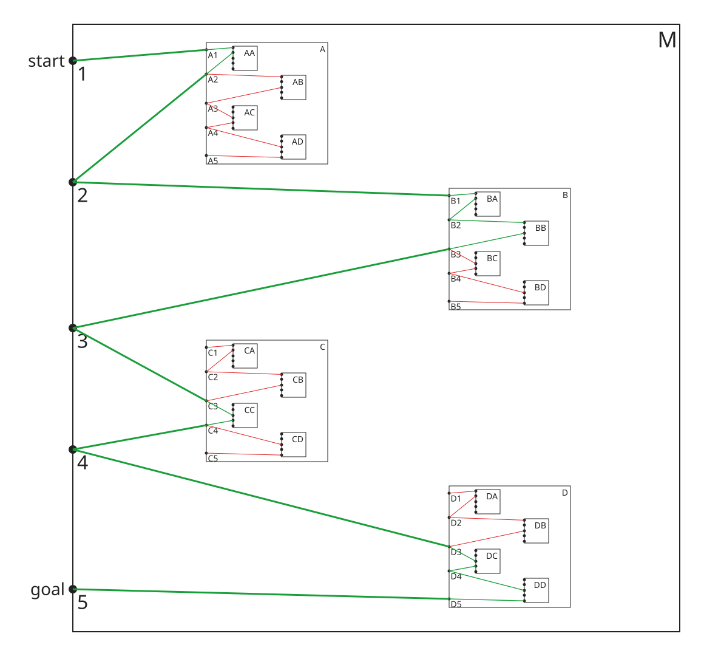

辺は $1-A1$, $2-A2$, $2-B1$, $3-B3$, $3-C3$, $4-C4$, $4-D3$, $5-D5$ の 8 本である。 $\omega+1$ 個の例の仕掛けを 2 つ直列に並べたものである。

経路は、 $start=1$ から $\omega+1$ 個の例と同じように $3$ に行く。 続けて、 同じ仕掛けをサブ迷路 $C, D$ で繰り返して $5=goal$ に行く。

ホップ点を通る順に並べると次のようになる。

```math
A^\omega \lt  BA^\omega \lt  BBA^\omega \lt  \cdots \lt  B^\omega \lt  C^\omega \lt  DC^\omega \lt  DDC^\omega \lt  \cdots \lt  D^\omega
```

無限ホップの個数は $(\omega+1)+(\omega+1) = \omega 2+1$ である。 前半の最後の $+1$ は、 後半の $\omega$ に吸収される ($1+\omega=\omega$)。

### ω^2+1 個の無限ホップをもつ無限フラクタル迷路の例
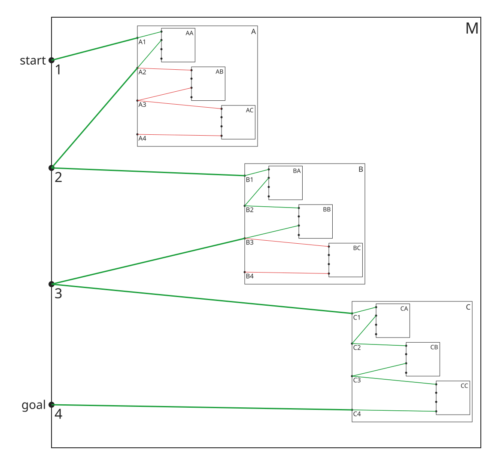

辺は $1-A1$, $2-A2$, $2-B1$, $3-B3$, $3-C1$, $4-C4$ の 6 本である。 $\omega+1$ 個の例に、 分岐点 $4$ とサブ迷路 $C$ を足したものである。

経路は、 $start=1$ から $\omega+1$ 個の例と同じように $3$ に行き、 $3 \rightarrow C1$ と進む。 $C1$ は $C$ の中の $1$ なので、 $C$ の中で同じことを繰り返して $C3$ に行き、 $C3 \rightarrow CC1$ と進む。 これを繰り返すと、 経路は $C^{\omega}$ に限りなく近づく。 そこで無限ホップし、 $\cdots \rightarrow CC4 \rightarrow C4 \rightarrow 4=goal$ と戻ってゴールに到達する。

$C^n$ の段ごとに $\omega+1$ 個のホップ点を通り、 その後に $C^\omega$ が 1 個あるので、 無限ホップの個数は次のようになる。

```math
(\omega+1)\omega+1 = \omega^2+1
```

ここで $(\omega+1)n = \omega n+1$ なので、 $n \rightarrow \omega$ の極限は $\omega^2$ である。

ルールでは、 $T=C$ で $1$ と $4$ を繋ぐ。 経路 $1 \rightarrow C1$ は $1 \rightsquigarrow 3 - C1$ と、 $\omega+1$ 個の例のホップを使う。 経路 $4 \rightarrow C4$ は辺 1 本である。

### ω^3+1 個の無限ホップをもつ無限フラクタル迷路の例


辺は $1-A1$, $2-A2$, $2-B1$, $3-B3$, $3-C1$, $4-C4$, $4-D1$, $5-D5$ の 8 本である。 $\omega^2+1$ 個の例に、 分岐点 $5$ とサブ迷路 $D$ を足したものである。

経路は、 $start=1$ から $\omega^2+1$ 個の例と同じように $4$ に行き、 $4 \rightarrow D1$ と進む。 $D$ の中で同じことを繰り返して $D4 \rightarrow DD1 \rightarrow \cdots$ と進み、 $D^{\omega}$ で無限ホップし、 $\cdots \rightarrow DD5 \rightarrow D5 \rightarrow 5=goal$ と戻ってゴールに到達する。

無限ホップの個数は次のようになる。

```math
(\omega^2+1)\omega+1 = \omega^3+1
```

ルールでは、 $T=D$ で $1$ と $5$ を繋ぐ。 経路 $1 \rightarrow D1$ は $1 \rightsquigarrow 4 - D1$ と、 $\omega^2+1$ 個の例のホップを使う。

### ω^k+1 個の無限ホップをもつ無限フラクタル迷路
同じ作り方を続ければ、 任意の自然数 $k$ について、 $\omega^k+1$ 個の無限ホップをもつ無限フラクタル迷路が作れる。

サブ迷路を $X_0, X_1, \ldots, X_k$、 分岐点を $1, 2, \ldots, k+2$ とし、 辺を次のように張る。 $start=1$, $goal=k+2$ とする。

- $1-X_01$, $2-X_02$
- $(i+1)-X_i1$, $(i+2)-X_i(i+2)$ ($i = 1, 2, \ldots, k$)

$k=0, 1, 2, 3$ がそれぞれ 1 個、 $\omega+1$ 個、 $\omega^2+1$ 個、 $\omega^3+1$ 個の例である ($X_0, X_1, X_2, X_3 = A, B, C, D$)。

$1$ から $i+2$ への解のホップ点の個数を $\alpha_i$ とする。 $1 \rightarrow X_i1$ の経路は $1 \rightsquigarrow i+1 - X_i1$ なので、 $X_i^n$ の段ごとに $\alpha_{i-1}$ 個のホップ点を通り、 最後に $X_i^\omega$ を通る。 したがって次が成り立つ。

```math
\begin{aligned}
\alpha_0 &=  1 \cr
\alpha_i &=  \alpha_{i-1}\omega+1
\end{aligned}
```

$\alpha_{i-1} = \omega^{i-1}+1$ ならば $\alpha_{i-1}n = \omega^{i-1}n+1$ なので、 $\alpha_{i-1}\omega = \omega^i$ である。 よって帰納法により $\alpha_k = \omega^k+1$ である。

分岐点は $k+2$ 個、 サブ迷路は $k+1$ 個で、 どちらも有限である。

### ω^ω 個の無限ホップをもつ無限フラクタル迷路が作れないことの証明
$\omega^k+1$ は $k$ をいくらでも大きくできるが、 $\omega^\omega$ 個には届かない。 これを証明する。

**定理.** 無限ホップルールのもとで、 どの無限フラクタル迷路のどの解についても、 そのホップ点の並びに $\omega^\omega$ は埋め込めない。 特に、 無限ホップの個数が $\omega^\omega$ (や $\omega^\omega+1$) になる解は存在しない。

**線形順序集合の演算.** 証明では **線形順序集合** を扱う。 線形順序集合とは、 集合 $L$ と、 その上の線形順序 $\lt$ (どの 2 元も大小を比べられる順序) の組 $(L, \lt )$ である。 順序が文脈から分かるときは $(L, \lt )$ を単に $L$ と書き、 「 $L$ の元」は集合 $L$ の元を指す。 順序数 $\omega^r$ も、 それより小さい順序数全体の集合に大小関係を入れた線形順序集合として扱う。

線形順序集合について、 次の演算と言葉を使う。

- **順序和** $L_1 \rightarrow L_2$: 集合 $L_1 \sqcup L_2$ (直和、 つまり共通の元がないものとして合わせた集合) に、 次の順序を入れた線形順序集合である。 この順序では、 $L_1$ のどの元も、 $L_2$ のどの元より小さい。 $x \lt y$ となるのは、 次のどれかのときである。
  - $x, y$ がどちらも $L_1$ の元で、 $L_1$ で $x \lt y$
  - $x, y$ がどちらも $L_2$ の元で、 $L_2$ で $x \lt y$
  - $x$ が $L_1$ の元で、 $y$ が $L_2$ の元

- **有限個の順序和** $\sum_{n\lt m} L_n$: $m$ についての再帰で次のように定める。 $\emptyset$ は空の線形順序集合である。

```math
\begin{aligned}
\sum_{n\lt 0} L_n &=  \emptyset \cr
\sum_{n\lt m+1} L_n &=  \left(\sum_{n\lt m} L_n\right) \rightarrow L_m
\end{aligned}
```

  $\sum_{n\lt m} L_n$ を $L_0 \rightarrow L_1 \rightarrow \cdots \rightarrow L_{m-1}$ とも書く。 $i \lt j$ ならば、 $L_i$ のどの元も $L_j$ のどの元より小さい。
- **ω 個の順序和** $\sum_{n\lt \omega} L_n$: 上の再帰では、 $\sum_{n\lt m} L_n$ は $\sum_{n\lt m+1} L_n$ の始切片 (ある元を含めば、 それより小さい元もすべて含む部分) になっている。 そこで、 すべての $m$ についての和集合

```math
\begin{aligned}
\sum_{n\lt \omega} L_n &=  \bigcup_{m\lt \omega} \sum_{n\lt m} L_n
\end{aligned}
```

  を ω 個の順序和と定め、 $L_0 \rightarrow L_1 \rightarrow L_2 \rightarrow \cdots$ とも書く。 2 元 $x, y$ の大小は、 両方を含む $\sum_{n\lt m} L_n$ での大小で決める (そのような $m$ のどれをとっても同じ結果になる)。 書き下すと、 集合 $\lbrace (n, x) \mid n \lt \omega,\ x \in L_n\rbrace$ に次の辞書式順序を入れたものである。

```math
\begin{aligned}
(n, x) \lt  (m, y) &\Leftrightarrow  n \lt  m \ \text{または}\ \left(n = m \ \text{かつ}\ L_n \ \text{で}\ x \lt  y\right)
\end{aligned}
```

  ω 個の順序和は、 $\sum_{n\lt \omega} L_n = L_0 \rightarrow \sum_{n\lt \omega} L_{n+1}$ という式を満たす。 ただし、 この式だけを定義にすることはできない。 例えば $L_n$ がどれも 1 点のとき、 $X = \lbrace p\rbrace  \rightarrow X$ を満たす $X$ は $\omega$ だけでなく、 $\omega$ の後ろに整数全体の順序を付けたものなどもあり、 1 つに決まらないからである。

- **逆順** $L^{\ast}$: 集合 $L$ に、 $L$ の大小を逆にした順序を入れた線形順序集合である。
- **1 点** $\lbrace p\rbrace$: 集合 $\lbrace p\rbrace$ に、 ただ 1 つの順序を入れた線形順序集合である。
- **埋め込める**: 線形順序集合 $K$ が線形順序集合 $L$ に埋め込めるとは、 写像 $f: K \rightarrow L$ で、 $x \lt y \Rightarrow f(x) \lt f(y)$ を満たすもの (順序埋め込み) があることである。 これは、 $L$ が $K$ と同じ順序型の部分集合を持つことと同じである ($K \subseteq L$ という意味ではない)。
- **同じ順序型**: 線形順序集合 $L$ と $K$ が同じ順序型であるとは、 全単射 $f: K \rightarrow L$ で、 $x \lt y \Leftrightarrow f(x) \lt f(y)$ を満たすもの (順序同型) があることである。

記号 $\rightarrow$ は経路 ($a_0 \rightarrow a_m$) や写像 ($f: K \rightarrow L$) にも使うが、 両側が線形順序集合のときは順序和を表す。 記号 $+$ は順序数の和にだけ使う。 $L_n$ がどれも順序数のとき、 順序和 $L_0 \rightarrow L_1 \rightarrow \cdots$ の順序型は、 順序数の和 $L_0 + L_1 + \cdots$ と一致する。 例えば $\sum_{n\lt \omega} \omega^r$ の順序型は $\omega^r + \omega^r + \cdots = \omega^{r+1}$ である。

**前提.** ルールを次のように読む。

1. 解は start から goal への有限の経路である。 1 歩は「辺を 1 本たどる」か「認められた無限ホップを 1 回する」かである。
2. 無限ホップ $h$ は、 無限ホップルールの記号 $S, T, U, V$ と分岐点 $1, 2$ を使って、 アドレス $SU1$ と $SV2$ の間を飛び越えるものである。 $S$ は 2 つのアドレスに共通する外側のサブ迷路列で、 $h$ は丸ごとサブ迷路 $S$ の中で起きる ($S$ が空なら迷路全体 $M$ の中)。 $h$ を認めるには、 2 本の有限の経路 $P: U1 \rightarrow TU1$ と $Q: V2 \rightarrow TV2$ を示す。 $P$, $Q$ の中の無限ホップは、 $h$ より前に認められたものに限る。
3. 無限ホップ $h$ の **深さ** $r(h)$ を、 $P$, $Q$ の中の無限ホップの深さの最大値に 1 を足したものとする ($P$, $Q$ に無限ホップがなければ $r(h)=1$)。 2 により、 $r(h)$ は有限の自然数である。
4. 経路 $P$ をサブ迷路列 $W$ の中に置いたコピーを $WP$ と書く (下図)。

   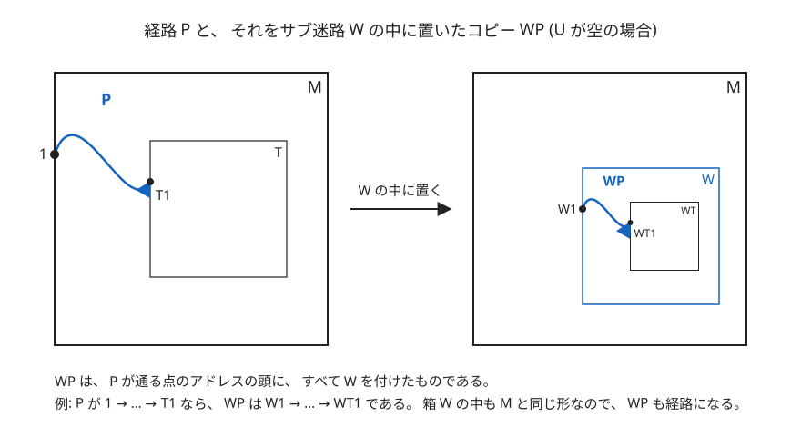

   無限ホップ $h$ を実際の経路に展開すると、 次の順に進む (下図)。
   - $SP, STP, ST^2P, \ldots$: $SU1$ から出発し、 $SU1 \rightarrow STU1 \rightarrow ST^2U1 \rightarrow \cdots$ と進んで $ST^\omega$ に近づく。
   - $ST^\omega$: $S$ に入り、 そのあと $T$ に無限に入り続けた先の 1 点である。 2 本の経路の間の幅 0 の隙間はここにあり、 $h$ のホップ点である。 例えば 1 個の例では $S$ は空、 $T = A$ なので $ST^\omega = A^\omega$ である。
   - $\ldots, ST^2Q, STQ, SQ$ (逆向き): $ST^\omega$ から離れ、 $\cdots \rightarrow STV2 \rightarrow SV2$ と進んで $SV2$ に着く。

   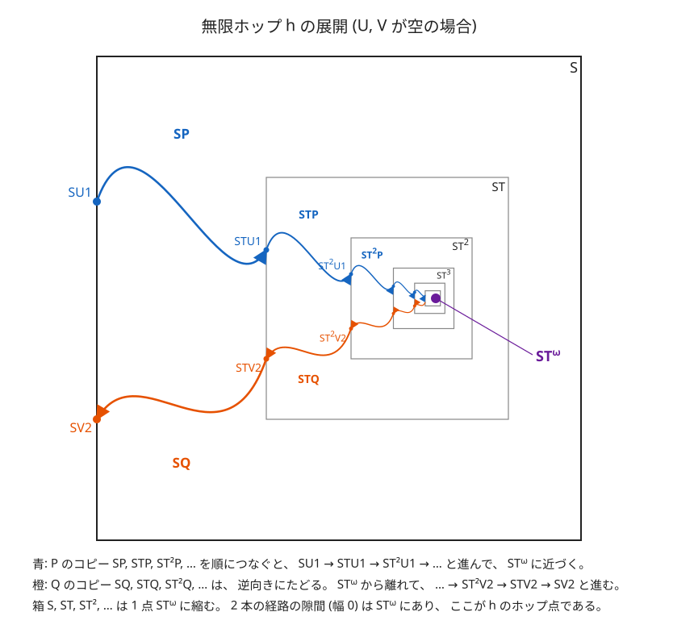

5. **ホップ点の並び $X$.** $X$ の引数は「無限ホップ (1 手)」または「経路」であり、 ホップ点そのものではない。
   - 無限ホップ $h$ に対して、 $X(h)$ は、 $h$ を 4 のように展開したときに渡るホップ点の集合に、 渡る順の順序を入れた線形順序集合である。 $X(h)$ には、 $h$ 自身のホップ点 $ST^\omega$ と、 $P$, $Q$ の中の無限ホップを展開したときに渡るホップ点が入る。
   - 経路 $\pi = (a_0, a_1, \ldots, a_m)$ に対して、 $X(\pi) = X_1 \rightarrow X_2 \rightarrow \cdots \rightarrow X_m$ と定める。 $X_i$ は $i$ 歩目 ($a_{i-1}$ から $a_i$ への 1 手) で渡るホップ点の線形順序集合で、 次のように決める。
     - 辺 1 本のとき: 空の線形順序集合
     - 無限ホップ $h$ を $SU1$ から $SV2$ の向きに通るとき: $X(h)$
     - 無限ホップ $h$ を逆向き ($SV2$ から $SU1$) に通るとき: $X(h)^{\ast}$

   この 2 つを使うと、 $X(h)$ は次のように書ける。

```math
\begin{aligned}
X(h) &=  \sum_{n\lt \omega} X(ST^nP) \rightarrow \{ST^\omega\} \rightarrow \left(\sum_{n\lt \omega} X(ST^nQ)\right)^*
\end{aligned}
```

右辺の $X(ST^nP)$ と $X(ST^nQ)$ は経路に対する $X$ で、 $X(h)$ は無限ホップに対する $X$ である。 $ST^nP$ は $P$ をサブ迷路 $ST^n$ の中にずらしたコピーなので、 $X(ST^nP)$ は $X(P)$ と同じ順序型である。 $Q$ についても同様である。

**記号.** 線形順序集合 $L$ に $\omega^r$ と $(\omega^r)^{\ast}$ の少なくとも一方が埋め込めることを $\Phi_r(L)$ と書く。 次が成り立つ。

- $r \leq r'$ ならば $\Phi_{r'}(L) \Rightarrow \Phi_r(L)$ である ( $\omega^r$ は $\omega^{r'}$ に埋め込めるので)。
- $\Phi_r(L) \Leftrightarrow \Phi_r(L^{\ast})$ である。
- 空の線形順序集合は、 どの $r$ についても $\Phi_r$ を満たさない。 $r \geq 1$ のとき、 1 点の線形順序集合も $\Phi_r$ を満たさない ( $\omega^r$ は無限集合なので)。

**補題 1 (2 個の順序和).** $\Phi_r(L_1 \rightarrow L_2)$ ならば、 $\Phi_r(L_1)$ または $\Phi_r(L_2)$ である。

*証明.* $\omega^r$ が $L_1 \rightarrow L_2$ に埋め込める場合を示す。 順序埋め込み $f: \omega^r \rightarrow L_1 \rightarrow L_2$ をとる。 $\omega^r$ の元のうち、 $f$ で $L_2$ に移るものの集合を $F = \lbrace x \in \omega^r \mid f(x) \in L_2\rbrace$ とする。 $L_2$ の元は $L_1$ のどの元よりも大きいので、 $x \in F$ かつ $x \lt y$ ならば $f(x) \lt f(y)$ より $f(y) \in L_2$、 つまり $y \in F$ である。 よって $F$ は $\omega^r$ の終切片 (ある元を含めば、 それより大きい元もすべて含む部分) である。

- $F$ が空でないとき: $\omega^r$ の空でない終切片は $\omega^r$ と同じ順序型である ( $\omega^r$ は加法的に分解できない)。 その順序同型 $g: \omega^r \rightarrow F$ と $f$ を合成した $f \circ g$ は $\omega^r$ から $L_2$ への順序埋め込みなので、 $\Phi_r(L_2)$ である。
- $F$ が空のとき: $f$ の像はすべて $L_1$ に入るので、 $f$ は $\omega^r$ から $L_1$ への順序埋め込みであり、 $\Phi_r(L_1)$ である。

$(\omega^r)^{\ast}$ が $L_1 \rightarrow L_2$ に埋め込める場合も、 $F$ の代わりに「 $f$ で $L_1$ に移る元の集合」(始切片になる) を考えれば同様である。 $\square$

**系 1 (有限個の順序和).** $\Phi_r(A_0 \rightarrow \cdots \rightarrow A_N)$ ならば、 ある $i \leq N$ について $\Phi_r(A_i)$ である。

*証明.* 次の命題 $\mathcal{S}(m)$ を $m$ についての帰納法で示し、 $m = N+1$ とすればよい ( $\sum_{n\lt N+1} A_n = A_0 \rightarrow \cdots \rightarrow A_N$ である)。

- $\mathcal{S}(m)$: $\Phi_r\left(\sum_{n\lt m} A_n\right)$ ならば、 ある $i \lt m$ について $\Phi_r(A_i)$ である。

$\mathcal{S}(0)$: $\sum_{n\lt 0} A_n$ は空なので $\Phi_r$ を満たさず、 仮定が成り立たない。 よって $\mathcal{S}(0)$ は成り立つ。

$\mathcal{S}(m)$ ならば $\mathcal{S}(m+1)$: 再帰の定義より $\sum_{n\lt m+1} A_n = \left(\sum_{n\lt m} A_n\right) \rightarrow A_m$ なので、 $\Phi_r\left(\sum_{n\lt m+1} A_n\right)$ ならば、 補題 1 より $\Phi_r\left(\sum_{n\lt m} A_n\right)$ または $\Phi_r(A_m)$ である。 前者なら $\mathcal{S}(m)$ より、 ある $i \lt m$ で $\Phi_r(A_i)$ である。 後者なら $i = m$ とすればよい。 $\square$

**補題 2 (ω 個の順序和).** $\Phi_{r+1}\left(\sum_{n\lt \omega} A_n\right)$ ならば、 ある $n$ について $\Phi_r(A_n)$ である。

*証明.* 次の事実を使う。 $\sum_{n\lt \omega} A_n$ の元は組 $(n, a)$ ($a \in A_n$) で、 1 つ目の成分が $n$ であることを「 $A_n$ に入る」という。

- **事実.** $u$ が $A_N$ に入り、 $v \leq u$ ならば、 $v$ は $A_0 \rightarrow \cdots \rightarrow A_N$ に入る。
- **理由.** $u = (N, a)$, $v = (n, b)$ とする。 辞書式順序の定義から、 $v \leq u$ は「 $n \lt N$」または「 $n = N$ かつ $A_N$ で $b \leq a$」のどちらかであり、 どちらでも $n \leq N$ である。 $\sum_{n\lt \omega} A_n$ のうち、 1 つ目の成分が $N$ 以下の元を集めた部分は、 和集合による定義での $\sum_{n\lt N+1} A_n = A_0 \rightarrow \cdots \rightarrow A_N$ である。 よって $v$ は $A_0 \rightarrow \cdots \rightarrow A_N$ に入る。

(1) $(\omega^{r+1})^{\ast}$ が埋め込める場合。 順序埋め込み $f: (\omega^{r+1})^{\ast} \rightarrow \sum_{n\lt \omega} A_n$ をとる。 $(\omega^{r+1})^{\ast}$ には最大元 $z$ がある ( $\omega^{r+1}$ の最小元 $0$ を逆順で見たもの)。 $f(z)$ はある $A_N$ に入る。 どの $x$ も $x \leq z$ なので $f(x) \leq f(z)$ であり、 上の事実より、 $f$ の像はすべて $A_0 \rightarrow \cdots \rightarrow A_N$ に入る。 したがって $f$ は $(\omega^{r+1})^{\ast}$ から $A_0 \rightarrow \cdots \rightarrow A_N$ への順序埋め込みである。 $(\omega^r)^{\ast}$ は $(\omega^{r+1})^{\ast}$ に埋め込めるので、 埋め込みを合成すると $(\omega^r)^{\ast}$ が $A_0 \rightarrow \cdots \rightarrow A_N$ に埋め込め、 $\Phi_r(A_0 \rightarrow \cdots \rightarrow A_N)$ である。 系 1 より、 ある $i \leq N$ について $\Phi_r(A_i)$ である。

(2) $\omega^{r+1}$ が埋め込める場合。 順序埋め込み $f: \omega^{r+1} \rightarrow \sum_{n\lt \omega} A_n$ をとる。 $\omega^{r+1}$ は $\omega^r \rightarrow \omega^r \rightarrow \cdots$ と同じ順序型なので、 $\omega^{r+1}$ の中に、 最初の $\omega^r$ に当たる部分 $B_0$ と、 2 つ目の $\omega^r$ に当たる部分 $B_1$ がある。 $B_0$ は順序型 $\omega^r$ で、 $B_0$ のどの元も $B_1$ のどの元より小さい。 $B_1$ の元 $y$ を 1 つとり、 $f(y)$ が入る $A_N$ を考える。 $B_0$ のどの元 $x$ も $x \lt y$ なので $f(x) \lt f(y)$ で、 上の事実より、 $f(x)$ は $A_0 \rightarrow \cdots \rightarrow A_N$ に入る。 よって $f$ を $B_0$ に制限したものは $B_0$ から $A_0 \rightarrow \cdots \rightarrow A_N$ への順序埋め込みで、 $\omega^r$ が $A_0 \rightarrow \cdots \rightarrow A_N$ に埋め込め、 $\Phi_r(A_0 \rightarrow \cdots \rightarrow A_N)$ である。 系 1 より、 ある $i \leq N$ について $\Phi_r(A_i)$ である。 $\square$

(2) の様子を下図に示す。

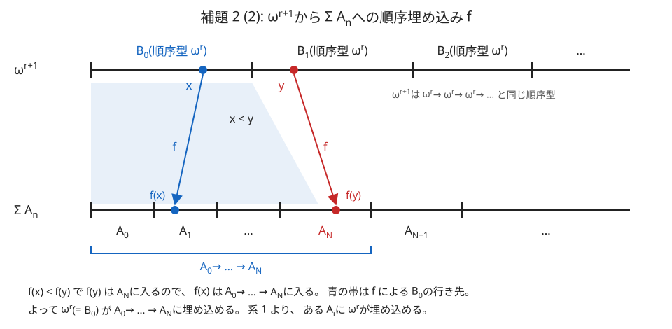

**主補題.** 無限ホップ $h$ と自然数 $k \geq 1$ について、 $\Phi_k(X(h))$ ならば $r(h) \geq k+1$ である。 特に、 $\Phi_{r(h)}(X(h))$ は成り立たない。

*証明.* 自然数 $k \geq 1$ について、 命題 $\mathcal{P}(k)$ を次のように定める。

- $\mathcal{P}(k)$: すべての無限ホップ $h$ について、 $\Phi_k(X(h))$ ならば $r(h) \geq k+1$ である。

以下の (i) と (ii) を示す。

**(i) $\mathcal{P}(1)$ が成り立つ。** $\Phi_1(X(h))$ とする。 1 点の線形順序集合は $\Phi_1$ を満たさないので、 $X(h)$ はホップ点 $ST^\omega$ の 1 点だけではない。 $X(h)$ の残りの元は $X(ST^nP)$ か $X(ST^nQ)$ の元なので、 ある $n$ で $X(ST^nP)$ か $X(ST^nQ)$ は空でない。 これは $P$ か $Q$ が無限ホップを含むことを意味し、 その深さは 1 以上なので、 深さの定義より $r(h) \geq 2$ である。

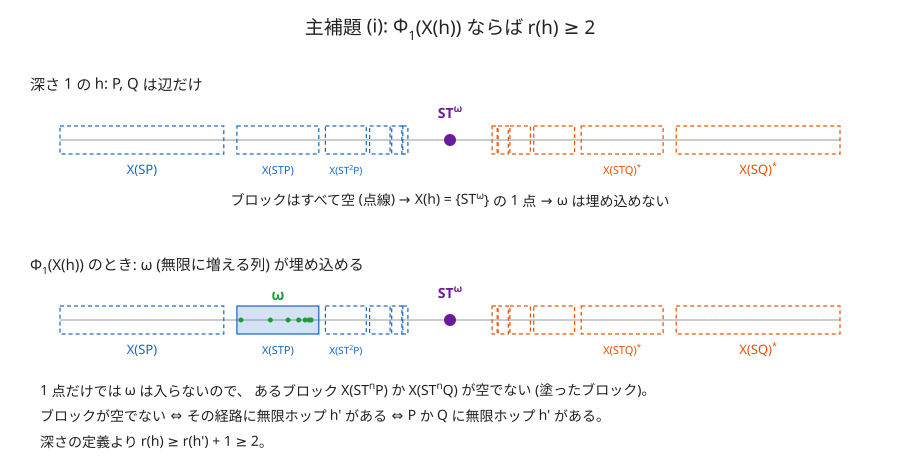

**(ii) どの $k \geq 1$ についても、 $\mathcal{P}(k)$ ならば $\mathcal{P}(k+1)$ である。** $\mathcal{P}(k)$ を仮定し、 $\Phi_{k+1}(X(h))$ となる無限ホップ $h$ をとる。 $X(h)$ は次の 3 つの順序和なので、 系 1 より、 そのどれかが $\Phi_{k+1}$ を満たす。

- 1 点 $\lbrace ST^\omega\rbrace$: 1 点は $\Phi_{k+1}$ を満たさないので、 この場合はない。
- $\sum_{n\lt \omega} X(ST^nP)$: 補題 2 より、 ある $n$ で $\Phi_k(X(ST^nP))$ である。 $X(ST^nP)$ は $X(P)$ と同じ順序型なので、 $\Phi_k(X(P))$ である。 $X(P)$ は $P$ の各歩の $X$ を有限個つないだ順序和なので、 系 1 より、 ある歩の $X$ が $\Phi_k$ を満たす。 辺 1 本の歩の $X$ は空で $\Phi_k$ を満たさないから、 その歩は無限ホップ $h'$ であり、 $\Phi_k(X(h'))$ である (逆向きに通る歩でも、 $\Phi_k$ は逆順で変わらない)。 $\mathcal{P}(k)$ より $r(h') \geq k+1$ である。 $h'$ は $P$ の中の無限ホップなので、 深さの定義より $r(h) \geq r(h')+1 \geq k+2$ である。
- $\left(\sum_{n\lt \omega} X(ST^nQ)\right)^{\ast}$: $\Phi_{k+1}$ は逆順で変わらないので $\Phi_{k+1}\left(\sum_{n\lt \omega} X(ST^nQ)\right)$ であり、 上と同じ議論で $r(h) \geq k+2$ である。

よって $\mathcal{P}(k+1)$ が成り立つ。

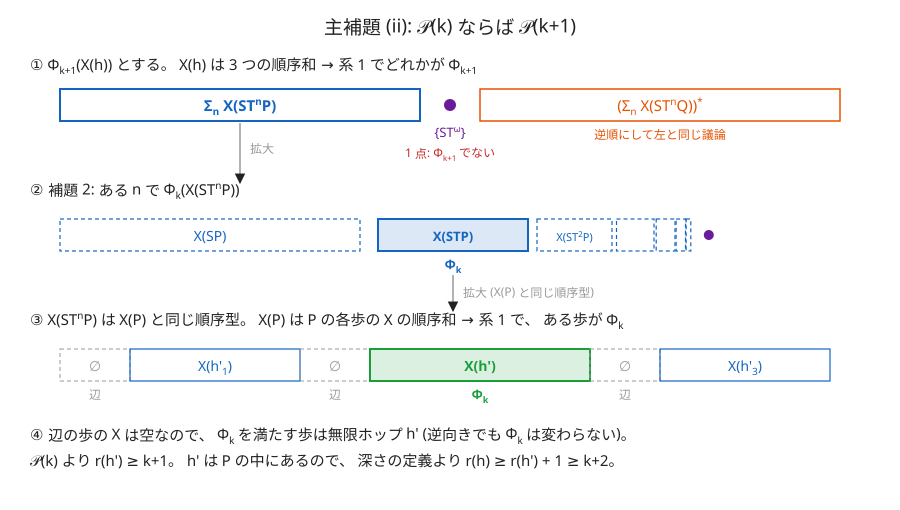

**(i) と (ii) から.** 数学的帰納法により、 すべての $k \geq 1$ について $\mathcal{P}(k)$ が成り立つ。 特に $k = r(h)$ とすると、 $\Phi_{r(h)}(X(h))$ ならば $r(h) \geq r(h)+1$ となるので、 $\Phi_{r(h)}(X(h))$ は成り立たない。 $\square$

*定理の証明.* 解を $\pi$ とする。 $\pi$ が無限ホップを含まなければ $X(\pi)$ は空なので、 何も埋め込めない。 そうでないとき、 $\pi$ に含まれる無限ホップは有限個なので、 その深さの最大値 $R$ がある。 $\omega^\omega$ が $X(\pi)$ に埋め込めるとすると、 $\omega^R$ は $\omega^\omega$ に埋め込めるので、 埋め込みを合成して $\Phi_R(X(\pi))$ である。 $X(\pi)$ は $\pi$ の各歩の $X$ を有限個つないだ順序和なので、 系 1 より、 ある歩の $X$ が $\Phi_R$ を満たす。 その歩は $\pi$ の中のある無限ホップ $h$ で、 $\Phi_R(X(h))$ である。 主補題より $r(h) \geq R+1$ となり、 $R$ が深さの最大値であることに反する。 よって $\omega^\omega$ は $X(\pi)$ に埋め込めない。 $\square$

$\omega^k+1$ 個の例は深さ $k+1$ の無限ホップで、 上限 $\omega^{k+1}$ より 1 段下の $\omega^k+1$ に達している。

## 参考文献
- 1999, M. J. P. Wolf, "FRACTAL MAZES", ENIGMA, Extropy #17, pp.67--68.
- 2023, Siggy, "Infinite Fractal Mazes", A Trivial Knot, Freethought Blogs. https://freethoughtblogs.com/atrivialknot/2023/10/21/infinite-fractal-mazes/
